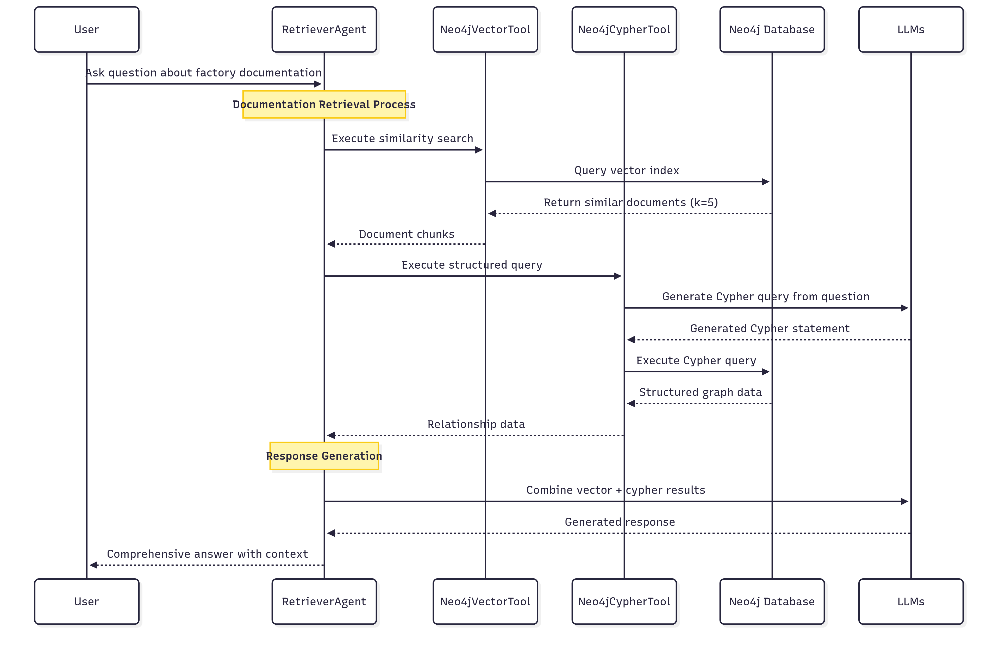
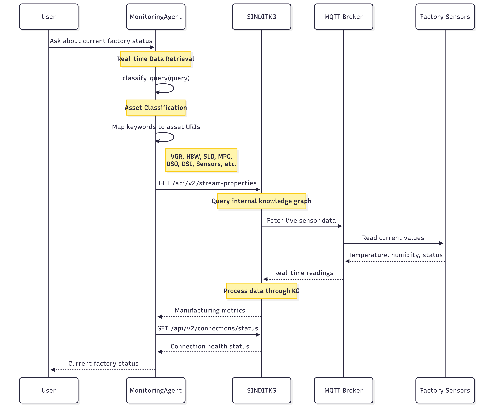
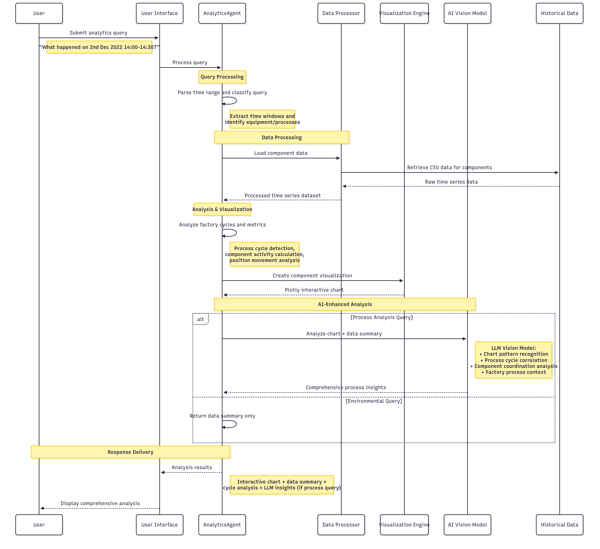
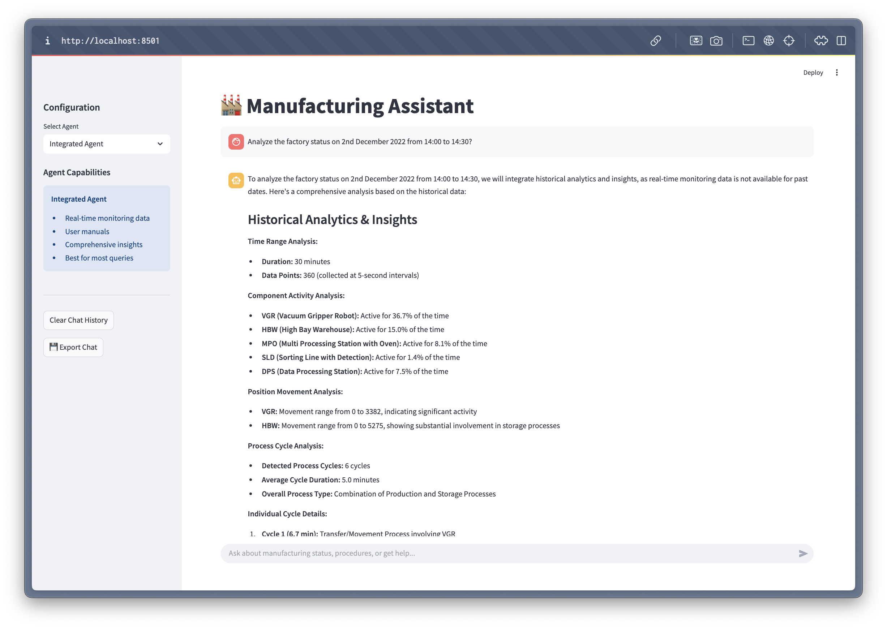
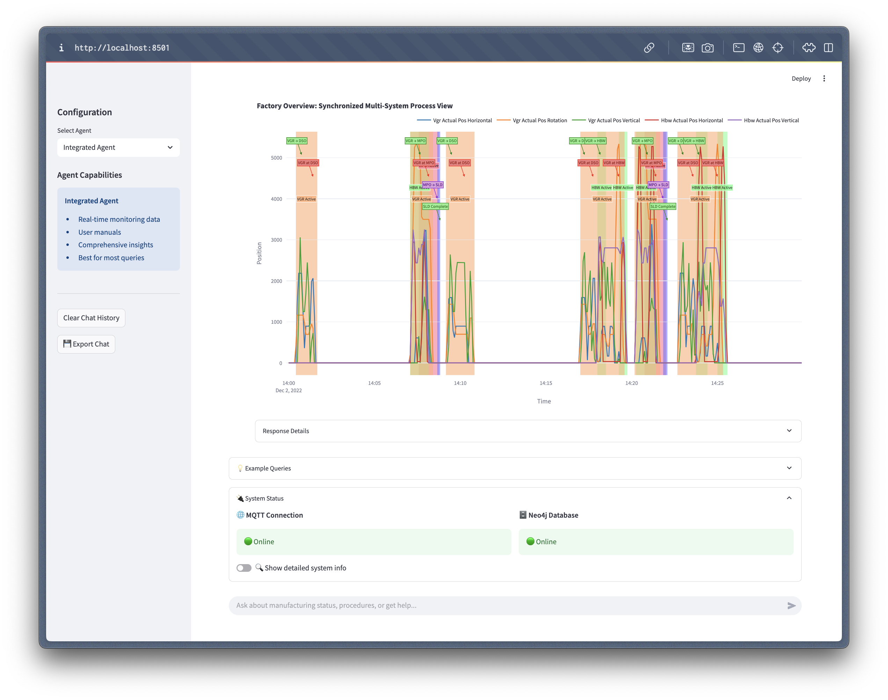

# LFLagents
Learning Feedback Loop agent-based approach is a multi-agent framework to assist users in retrieving information and monitoring the factory status. Three main components of the framework are being constructed: 

- Generative AI and LLMs-based Analysis Module: Collect real-time and historical data from the Sensors and IoT Devices in the manufacturing process as well as gather insights and observations from operators through visual interfaces and plain language inputs (using GUIs). Analyzing trends and processing real-time and historical data to help guide decisions.

- Interactive Dashboards and GUIs: Give operators user-friendly graphical interfaces so they can see trends and statistical analysis. Offer operators the ability to interact with data, investigate various scenarios, and provide feedback.

- Recommendation Module: (Real-time) manufacturing process reconfiguration suggestions may be made by using AI agents to automatically produce feedback and recommendations based on data analysis and trend indicators.

Generative AI and LLMs-based Analysis Module has been developed first with a Retriever Agent, which constructs a Neo4j graph (Knowledge Graph) and a Neo4j Vector Index from unstructured data extracted from manual user PDF files. The Retriever Agent integrates Neo4j graph database tools and OpenAI's language models to provide a retrieval-augmented generation (RAG) system. It combines structured and unstructured data to answer user queries effectively. Second, we have been working on a Monitoring Agent to provide real-time monitoring and analysis of manufacturing data by interface with the Knowledge Graph API. Third, we have been developing an integrated agent approach, combining the strengths of both the RetrieverAgent and the MonitoringAgent into the Integrated Agent to provide a unified interface for factory information retrieval and real-time monitoring.

## Getting Started

### 1. Clone the repository

```bash
git clone https://github.com/SINTEF-9012/LFLagents.git
```

### 2. Install the requirements`

```bash
pip install -r requirements.txt
```

### 3. Using Docker-Compose

Run the application using the default `docker-compose` configuration.

```bash
docker-compose up
```

### 4. Configure env variable

For example, create a `.env` file with the following content:

```bash
# Neo4j
NEO4J_URL=bolt://localhost:7687
NEO4J_USERNAME=neo4j
NEO4J_PASSWORD=<your_password>
NEO4J_AUTH=${NEO4J_USERNAME}/${NEO4J_PASSWORD}
NEO4J_APOC_EXPORT_FILE_ENABLED=true
NEO4J_APOC_IMPORT_FILE_ENABLED=true
NEO4J_APOC_IMPORT_FILE_USE_NEO4J_CONFIG=true
NEO4J_PLUGINS=["apoc", "graph-data-science"]

# OpenAI API
OPENAI_API_KEY=your_openai_api_key
CHAT_MODEL = "gpt-4o"
EMBEDDING_MODEL = "text-embedding-3-small"
```

## Overview

In this project we develop a multi-agent system on Fischertechnik Training Factory to assist users in retrieving information, monitoring factory status, and analyzing manufacturing data.


There are 6 main components of the factory: Deliver and Pick-up Station (DPS), Environmental station with surveillance camera (SSC),Vacuum Gripper Robot (VGR), Automated High-bay Warehouse (HBW), Multi-Processing Station with klin (MPO) and Sorting Line with Color Detection (SLD).


## Part 1: Retriever Agent

The RetrieverAgent handles factory documentation retrieval using a sophisticated knowledge graph approach. It combines structured and unstructured data to provide comprehensive answers to user queries.




### 1. Neo4j DB construction

This process involves constructing a Neo4j graph and a Neo4j Vector Index from unstructured data extracted from manual user PDF files. The graph extracts nodes and relationships from the text chunks of the PDF files. The source documents are stored in the graph and marked with the `document` node label. These `document` nodes are then used to create the Neo4j Vector Index, enabling efficient retrieval and augmentation of information from the graph database.

1. Load and Chunk PDF Files:
   - PDF files are loaded and split into smaller chunks for easier processing.
   - File: `src/utils/pdf_processing.py`
   - Function: `load_and_chunk_pdf(folder_path: str)`

2. Neo4j Graph Connection:
   - A connection to the Neo4j database is established.
   - File: `src/utils/neo4j_connection.py`
   - Class: `Neo4jGraph`
   - Functions:
     - `add_graph_documents(graph_documents)`
     - `clean_graph()`

3. Graph Modeling and Mapping: 
   - The extracted nodes and relationships are modeled and mapped to base types for compatibility with Neo4j.
   - File: `src/utils/graph_modeling.py` and `src/utils/graph_mapping.py`
   - Classes
     - `Property`
     - `Node`
     - `Relationship`
     - `KnowledgeGraph`
     - *Notes: as OpenAI functions don't currently support a dictionary object as a value, we have to overwritten the properties value to be a list of Property classes instead of a dictionary. Then we combine the nodes and relationships in a single class called KnowledgeGraph.*
   - Functions: 
     - `format_property_keys(str)`
     - `props_to_dict(props)`
     - `map_to_base_node(node)`
     - `map_to_base_relationship(rel)`

4. Extract Graph Data:
   - Each chunk of text is analyzed to extract nodes and relationships using `GPT_MODEL` (configured in `.env`).
   - File: `src/utils/graph_transformer.py`
   - Function: `extract_and_store_graph(document, nodes, rels)`
     - Modify: stores the `source` document and links it to nodes in the graph using the MENTIONS relationship.

5. Store Graph Data:
   - The extracted nodes and relationships are stored in the Neo4j database.
   - File: `src/transform_manual_file_to_graph.py`
   - Function: `process_pdf_file(file_path: str`
   - Description: Orchestrates the entire process of loading PDFs, extracting graph data, and storing it in Neo4j.

6. Create Neo4j Vector Index:
   - After storing the graph data, a Neo4j Vector Index is created and updated for efficient similarity search and retrieval. The index is built using OpenAI's embedding model (text-embedding-3-small) and applied to the Document nodes in the graph.
   - File: `src/utils/neo4j_connection.py`
   - Function:
     - `create_vector_index()`: Creates the vector index for `Document` nodes if it does not already exist.
     - `update_vector_index()`: Updates the vector index by embedding the text property of Document nodes and storing the embeddings in the embedding property.

To construct the Neo4j graph from unstructured data, run the following command:

```python
python src/transform_manual_file_to_graph.py
```

This script processes the PDF files in the `manual` folder, extracts graph data, and stores it in the Neo4j database.


<p align="center">
   <em>Information Extraction Pipeline from Text to Knowledge Graph</em>
</p>


<p align="center">
   <em>Snapshot of KG with explicit links between structured information and unstructured text</em>
</p>

### 2. Retrieval Augmented Generation (RAG) with RetrieverAgent

The `RetrieverAgent` (`src/retriever_agent.py`)integrates Neo4j graph database tools and OpenAI's language models to provide a retrieval-augmented generation (RAG) system. It combines structured and unstructured data to answer user queries effectively.

 - `Neo4jVectorTool`
   - Performs similarity-based retrieval from the `Neo4jVector` index.
   - Retrieves the most relevant documents based on the user's query.
 - `Neo4jCypherTool`
   - Executes Cypher queries to retrieve structured knowledge from the Neo4j graph.
   - Generates Cypher statements using OpenAI's language model
 - `RetrieverAgent`
   - Combines the results from both tools to provide a comprehensive answer to user queries.
   - Uses OpenAI's chat models to generate responses by integrating results from both tools.
   - Maintains chat history using Streamlit's session state and a conversation buffer.
   - Prompt Engineering:
     - The system prompt guides the assistant to provide concise, accurate, and relevant responses.
     - The assistant covers topics such as:
       - Factory components (e.g., high-bay warehouse, suction gripper, sorting line).
       - IoT Gateway, Node-RED dashboards, and cloud integration.
       - Programming tasks, system setup, and educational simulations.

## Part 2: Monitoring Agent

The MonitoringAgent provides real-time monitoring capabilities by interfacing with the SINDIT Knowledge Graph-based Digital Twin framework.




### 1. Set Up the SINDIT Knowledge Graph-Based DT Framework

SINDIT is structured according to the reference architecture for digital twin (DT) systems developed in the COGNIMAN project. It enhances flexibility and modularity through interfaces that connect different components for building knowledge graph-based DTs. See the [SINDIT documentation](https://github.com/SINTEF-9012/SINDIT20) to set up the framework.


<p align="center">
  <em>SINDIT Knowledge Graph Information Model</em>
</p>

The Data Layer of the Fischertechnik Digital Twin uses MQTT Data Connectors to stream real-time data from the factory's sensors and devices. Refer the MQTT broker setup in the [fischertechnik/txt_training_factory repository](https://github.com/fischertechnik/txt_training_factory/tree/master).


<p align="center">
  <em>Snapshot of the real-time data from MQTT broker</em>
</p>

The connection details are specified in `src/config/connections.json`, where you will see fields like `username` and `passwordPath` for the MQTT connection.

Before setting up the connector, we need to securely store the MQTT credentials. Use the SINDIT DT Platform endpoint `POST vault/secrets` to save the username and password. This ensures that confidential information is managed securely before establishing the MQTT connection.

To automate the setup of the SINDIT knowledge graph and its connections, run the following script:

```bash
python src/sindit_kg.py
``` 

This script streamlines the process of registering MQTT connections, streaming properties, assets, and the knowledge graph itself by interacting with the SINDIT DT Platform. Running the script ensures that all necessary components are properly configured for real-time monitoring and data integration.
   - Register the MQTT connection
   - Register all streaming properties (from `src/sindit2-connection/config/streaming_properties.json`)
   - Register all assets (factory sensor, camera, VGR, HBW, SLD, MPO, DSO, DSI, order)
   - Register the SINDIT knowledge graph (`sindit_kg`)


<p align="center">
  <em>Result: Snapshot of the SINDIT graph created for the Fischertechnik factorys</em>
</p>

### 2. Monitoring Agent Architecture

The `MonitoringAgent` (`src/monitoring_agent.py`) is designed to provide real-time monitoring and analysis of manufacturing data by interfacing with the SINDIT Knowledge Graph API. Below is an overview of its main components and functionalities:
  - `SINDITDataTool`: A custom tool that classifies user queries, determines relevant manufacturing assets (e.g., VGR, HBW, sensors), and retrieves real-time data from the SINDIT API. It maps natural language queries to specific asset URIs and fetches associated data, including sensor readings and connection status.
  - `classify_query`: analyzes the user's natural language query to identify relevant manufacturing assets (such as VGR, HBW, sensors, etc.). It maps keywords in the query to specific asset URIs used by the SINDIT Knowledge Graph API, ensuring that data retrieval targets the most relevant components for the user's request.
  - `get_real_time_data`: Retrieves real-time manufacturing data from the SINDIT Knowledge Graph API based on a user query and optional asset/property filters.
  - `query`: The main entry point for user queries. It retrieves real-time data, formats it with the original query, and generates a comprehensive response using the LLM conversation chain.
  - `get_sindit_status`: Fetches the connection status of MQTT connections from the SINDIT Knowledge Graph API.

## Part 3: AnalyticsAgent

The AnalyticsAgent provides comprehensive historical data analysis, visualization, and LLM-powered insights for manufacturing processes.



- **Advanced Analytics**:
  - Process cycle detection
  - Component activity calculation
  - Position movement analysis
  - Environmental condition monitoring

- **LLM-Powered Insights**: Generates comprehensive process explanations using multimodal chart analysis
  

1. Time Series Loading: Load resampled component data
   - File: `src/utils/ts_preprocessing.py`
   - Function: `load_resampled_requested_components()`

2. Visualization Engine: Create interactive charts
   - File: `src/viz.py`
   - Functions: `visualize_factory_overview()`, `visualize_component_activity()`

3. Multimodal LLM Analysis: Generate insights from chart data using advanced multimodal AI
   - File: `src/utils/llm_image_explanation.py`
   - Function: `generate_comprehensive_process_explanation()`
     - Visual + Textual Processing: Combines factory process charts with time series data
     - GPT-4 Vision Integration: Uses multimodal capabilities to analyze charts and correlate with numerical data
     - Domain-Specific Analysis: Tailored for manufacturing processes and factory operations
       - Process cycle detection
       - Component activity calculation
       - Position movement analysis
       - Environmental condition monitoring

## Part 4: Integrated Agent

The Integrated Agent provides a unified interface for factory information retrieval, real-time monitoring, and advanced analytics by orchestrating multiple specialized agents:
  - `RetrieverAgent`: Handles knowledge retrieval, question answering, and context augmentation using the Neo4j knowledge graph and OpenAI models. It is optimized for answering questions about factory structure, documentation, and historical data.
  - `MonitoringAgent`: Focuses on real-time data monitoring, sensor status, and operational insights by interfacing with the SINDIT Knowledge Graph API.
  - `AnalyticsAgent`: Powers historical data analysis, visualization, and AI-driven insights. It supports natural language queries for time series analysis, process cycle detection, and component activity evaluation, leveraging multimodal LLMs for comprehensive process explanations.


## Result

The demo highlights the full capabilities of the multi-agent manufacturing assistant system within a Streamlit application. Users can interact with the following agents:
   - `RetrieverAgent`: Provides knowledge retrieval, question answering, and context augmentation using the Neo4j knowledge graph and OpenAI models.
   - `MonitoringAgent`: Offers real-time data monitoring, sensor status, and operational insights by interfacing with the SINDIT Knowledge Graph API.
   - `AnalyticsAgent`: Delivers historical data analysis, visualization, and AI-driven insights. It supports natural language queries for time series analysis, process cycle detection, and component activity evaluation, leveraging multimodal LLMs for comprehensive process explanations.
   - `IntegratedAgent`: Combines the functionalities of the above agents to provide a seamless user experience for factory information retrieval, real-time monitoring, and advanced analytics.
  
To run the demo, execute the following command:

```bash
streamlit run src/app.py
```

This command starts the Streamlit application, providing a user-friendly interface for interacting with the agents and visualizing the factory's status.



