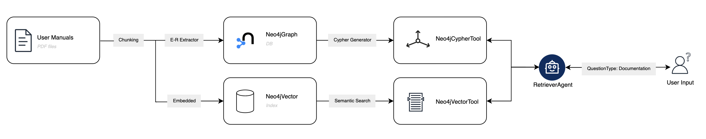
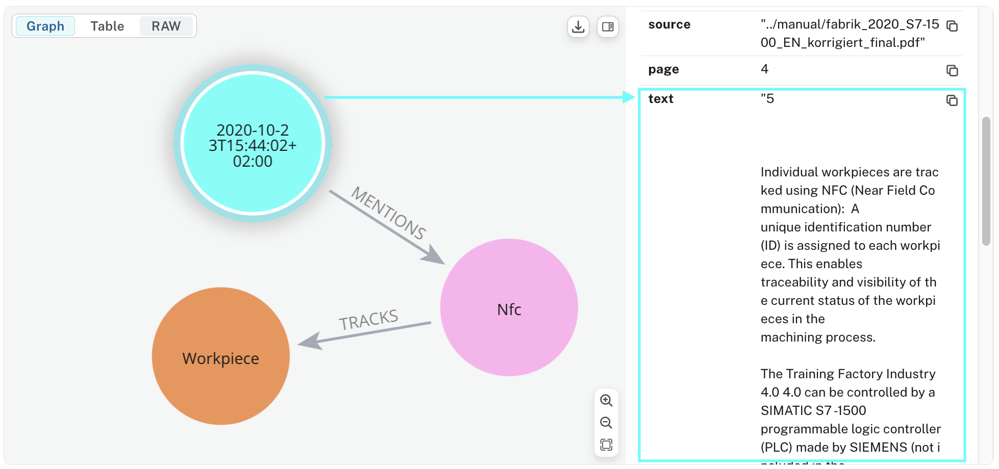
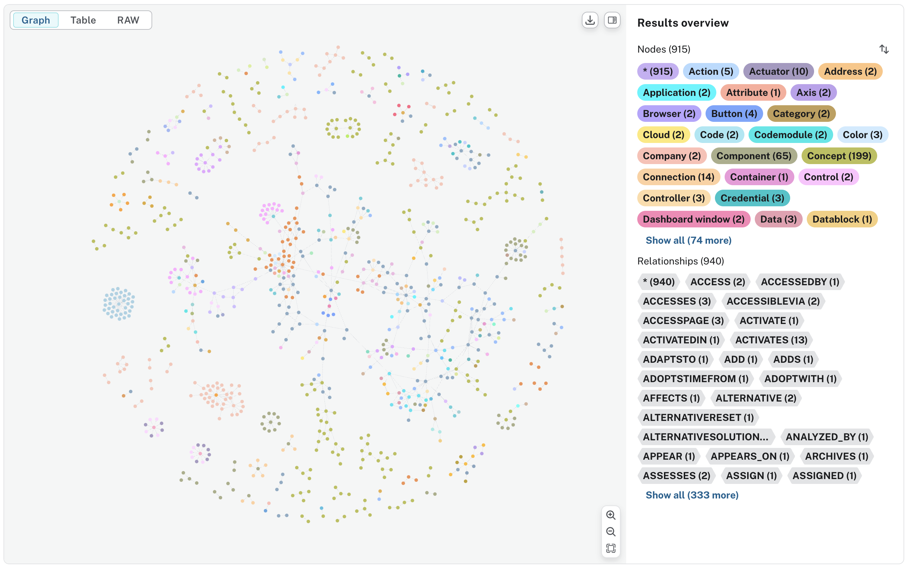
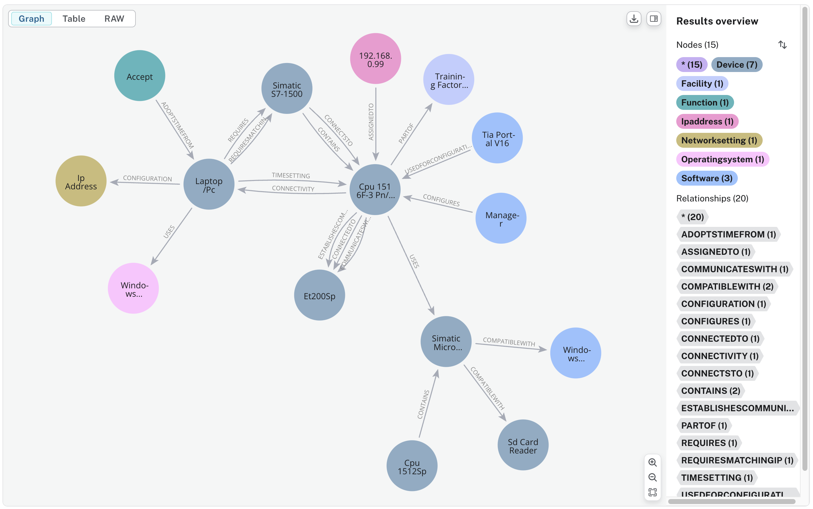
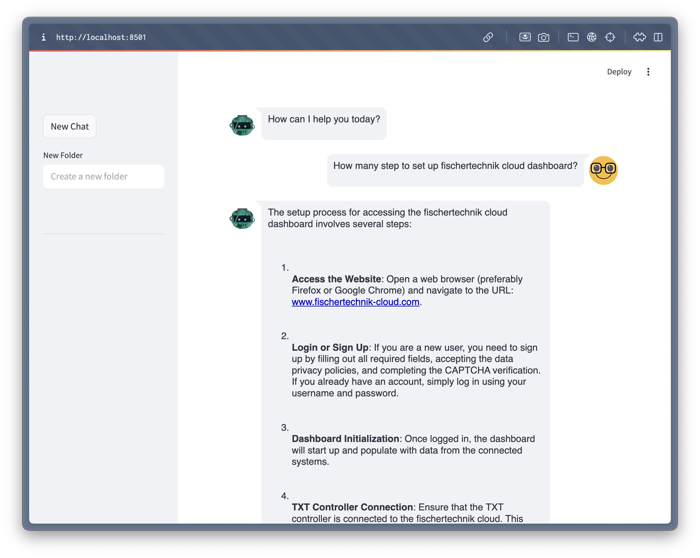
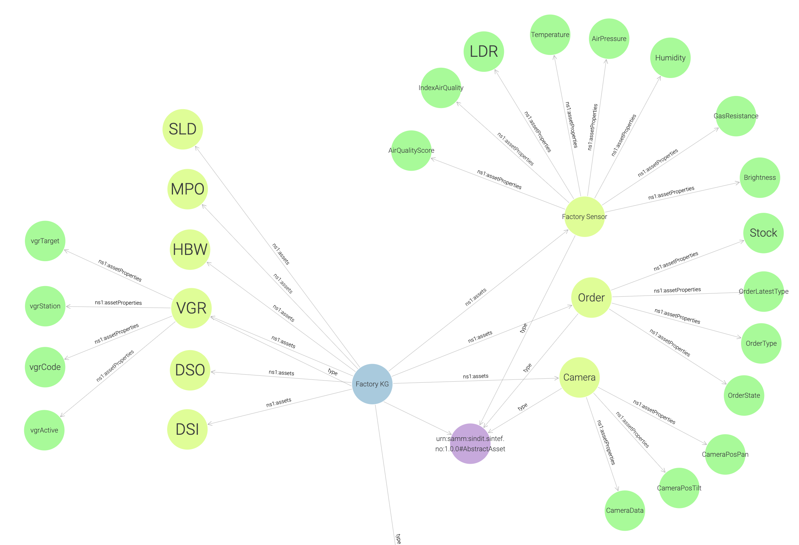

# LFLagents
Learning Feedback Loop agent-based approach

## Getting Started

### 1. Clone the repository

```bash
git clone https://github.com/SINTEF-9012/LFLagents.git
```

### 2. Install the requirements`

```bash
pip install -r requirements.txt
```

### 3. Using Docker-Compose

Run the application using the default `docker-compose` configuration.

```bash
docker-compose up
```

### 4. Configure env variable

For example, create a `.env` file with the following content:

```bash
# Neo4j
NEO4J_URL=bolt://localhost:7687
NEO4J_USERNAME=neo4j
NEO4J_PASSWORD=<your_password>
NEO4J_AUTH=${NEO4J_USERNAME}/${NEO4J_PASSWORD}
NEO4J_APOC_EXPORT_FILE_ENABLED=true
NEO4J_APOC_IMPORT_FILE_ENABLED=true
NEO4J_APOC_IMPORT_FILE_USE_NEO4J_CONFIG=true
NEO4J_PLUGINS=["apoc", "graph-data-science"]

# OpenAI API
OPENAI_API_KEY=your_openai_api_key
CHAT_MODEL = "gpt-4o"
EMBEDDING_MODEL = "text-embedding-3-small"
```
## Part 0: Overview


In this project we develop a multi-agent system on Fischertechnik Training Factory to assist users in retrieving information and monitoring the factory status. 

There are 6 main components of the factory: Deliver and Pick-up Station (DPS), Environmental station with surveillance camera (SSC),Vacuum Gripper Robot (VGR), Automated High-bay Warehouse (HBW), Multi-Processing Station with klin (MPO) and Sorting Line with Color Detection (SLD).


## Part 1: Retriever Agent



### 1. Neo4j DB construction

This process involves constructing a Neo4j graph and a Neo4j Vector Index from unstructured data extracted from manual user PDF files. The graph extracts nodes and relationships from the text chunks of the PDF files. The source documents are stored in the graph and marked with the `document` node label. These `document` nodes are then used to create the Neo4j Vector Index, enabling efficient retrieval and augmentation of information from the graph database.

1. Load and Chunk PDF Files:
   - PDF files are loaded and split into smaller chunks for easier processing.
   - File: `src/utils/pdf_processing.py`
   - Function: `load_and_chunk_pdf(folder_path: str)`

2. Neo4j Graph Connection:
   - A connection to the Neo4j database is established.
   - File: `src/utils/neo4j_connection.py`
   - Class: `Neo4jGraph`
   - Functions:
     - `add_graph_documents(graph_documents)`
     - `clean_graph()`

3. Graph Modeling and Mapping: 
   - The extracted nodes and relationships are modeled and mapped to base types for compatibility with Neo4j.
   - File: `src/utils/graph_modeling.py` and `src/utils/graph_mapping.py`
   - Classes
     - `Property`
     - `Node`
     - `Relationship`
     - `KnowledgeGraph`
     - *Notes: as OpenAI functions don't currently support a dictionary object as a value, we have to overwritten the properties value to be a list of Property classes instead of a dictionary. Then we combine the nodes and relationships in a single class called KnowledgeGraph.*
   - Functions: 
     - `format_property_keys(str)`
     - `props_to_dict(props)`
     - `map_to_base_node(node)`
     - `map_to_base_relationship(rel)`

4. Extract Graph Data:
   - Each chunk of text is analyzed to extract nodes and relationships using `GPT_MODEL` (configured in `.env`).
   - File: `src/utils/graph_transformer.py`
   - Function: `extract_and_store_graph(document, nodes, rels)`
     - Modify: stores the `source` document and links it to nodes in the graph using the MENTIONS relationship.
    

5. Store Graph Data:
   - The extracted nodes and relationships are stored in the Neo4j database.
   - File: `src/transform_manual_file_to_graph.py`
   - Function: `process_pdf_file(file_path: str`
   - Description: Orchestrates the entire process of loading PDFs, extracting graph data, and storing it in Neo4j.

6. Create Neo4j Vector Index:
   - After storing the graph data, a Neo4j Vector Index is created and updated for efficient similarity search and retrieval. The index is built using OpenAI's embedding model (text-embedding-3-small) and applied to the Document nodes in the graph.
   - File: `src/utils/neo4j_connection.py`
   - Function:
     - `create_vector_index()`: Creates the vector index for `Document` nodes if it does not already exist.
     - `update_vector_index()`: Updates the vector index by embedding the text property of Document nodes and storing the embeddings in the embedding property.

To construct the Neo4j graph from unstructured data, run the following command:

```python
python src/transform_manual_file_to_graph.py
```

This script processes the PDF files in the `manual` folder, extracts graph data, and stores it in the Neo4j database.


<p align="center">
   <em>Visualization of the overall graph generated by the language model.</em>
</p>


<p align="center">
   <em>Visualization of the graph generated by the language model with details view.</em>
</p>

### 2. Retrieval Augmented Generation (RAG) with RetrieverAgent

The `RetrieverAgent` integrates Neo4j graph database tools and OpenAI's language models to provide a retrieval-augmented generation (RAG) system. It combines structured and unstructured data to answer user queries effectively.

   - File: `src/retriever_agent.py`
     - `Neo4jVectorTool`
       - Performs similarity-based retrieval from the `Neo4jVector` index.
       - Retrieves the most relevant documents based on the user's query.
     - `Neo4jCypherTool`
       - Executes Cypher queries to retrieve structured knowledge from the Neo4j graph.
       - Generates Cypher statements using OpenAI's language model
     - `RetrieverAgent`
       - Combines the results from both tools to provide a comprehensive answer to user queries.
       - Uses OpenAI's chat models to generate responses by integrating results from both tools.
       - Maintains chat history using Streamlit's session state and a conversation buffer.
       - Prompt Engineering:
         - The system prompt guides the assistant to provide concise, accurate, and relevant responses.
         - The assistant covers topics such as:
           - Factory components (e.g., high-bay warehouse, suction gripper, sorting line).
           - IoT Gateway, Node-RED dashboards, and cloud integration.
           - Programming tasks, system setup, and educational simulations.
   - File: `src/app.py`
     - Implements a Streamlit web application to interact with the `RetrieverAgent`.
     - Provides a user-friendly interface for querying the Neo4j graph and receiving augmented responses.

### 3. Running the Streamlit Application

```bash
streamlit run src/app.py
```

This command starts the Streamlit application, allowing users to interact with the `RetrieverAgent` through a web interface.



## Part 2: Monitoring Agent

[IN PROGRESS] The Monitoring Agent is designed to monitor the factory's status and provide real-time updates. It uses the SINDIT platform to collect data from various sensors and devices in the factory, processes this data, and retrieves relevant information from SINDIT to provide insights into factory operations.

### 1. Set Up the SINDIT Knowledge Graph-Based DT Framework

SINDIT is structured according to the reference architecture for digital twin (DT) systems developed in the COGNIMAN project. It enhances flexibility and modularity through interfaces that connect different components for building knowledge graph-based DTs. See the [SINDIT documentation](https://github.com/SINTEF-9012/SINDIT20) to set up the framework.


<p align="center">
  <em>SINDIT Knowledge Graph Information Model</em>
</p>

The Data Layer of the Fischertechnik Digital Twin uses MQTT Data Connectors to stream real-time data from the factory's sensors and devices. Refer the MQTT broker setup in the [fischertechnik/txt_training_factory repository](https://github.com/fischertechnik/txt_training_factory/tree/master).


<p align="center">
  <em>Snapshot of the real-time data from MQTT broker</em>
</p>

The connection details are specified in `src/config/connections.json`, where you will see fields like `username` and `passwordPath` for the MQTT connection.

Before setting up the connector, we need to securely store the MQTT credentials. Use the SINDIT API endpoint `POST vault/secrets` to save the username and password. This ensures that confidential information is managed securely before establishing the MQTT connection.

To automate the setup of the SINDIT knowledge graph and its connections, run the following script:

```bash
python src/sindit_kg.py
``` 

This script streamlines the process of registering MQTT connections, streaming properties, assets, and the knowledge graph itself by interacting with the SINDIT API. Running the script ensures that all necessary components are properly configured for real-time monitoring and data integration.
   - Register the MQTT connection
   - Register all streaming properties
   - Register all assets (factory sensor, camera, VGR, HBW, SLD, MPO, DSO, DSI, order)
   - Register the SINDIT knowledge graph (`sindit_kg`)



<p align="center">
  <em>Result: Snapshot of the SINDIT graph created for the Fischertechnik factorys</em>
</p>