# LFLagents

Learning Feedback Loop agent-based approach is a multi-agent framework to assist users in retrieving information and monitoring the factory status. Three main components of the framework are being constructed: 

- Generative AI and LLMs-based Analysis Module: Collect real-time and historical data from the Sensors and IoT Devices in the manufacturing process as well as gather insights and observations from operators through visual interfaces and plain language inputs (using GUIs). This module analyzes trends and processes real-time and historical data to help guide decisions.

- Interactive Dashboards and GUIs: Give operators user-friendly graphical interfaces so they can see trends and statistical analysis. Enable operators to interact with data, explore various scenarios, and provide feedback.

- Recommendation Module: (Real-time) manufacturing process reconfiguration suggestions may be made by using AI agents to automatically produce feedback and recommendations based on data analysis and trend indicators.

Generative AI and LLMs-based Analysis Module has been developed first with a Retriever Agent, which constructs a Neo4j graph (Knowledge Graph) and a Neo4j Vector Index from unstructured data extracted from manual user PDF files. The Retriever Agent integrates Neo4j graph database tools and large language models to provide a retrieval-augmented generation (RAG) system. It combines structured and unstructured data to answer user queries effectively. Second, we have been working on a Monitoring Agent to provide real-time monitoring and analysis of manufacturing data by interface with the Knowledge Graph API. Third, the Analytics Agent provides semantic insights and interprets charts from historical sensor data by computing relevant metrics and detecting patterns. Finally, we have been developing an integrated agent approach, combining the strengths of the RetrieverAgent, the MonitoringAgent and the AnalyticsAgent into the Integrated Agent to provide a unified interface for factory information retrieval, real-time monitoring and time-series analytics within a single interactive agent framework.

## Getting Started

### 1. Clone the repository

```bash
git clone https://github.com/SINTEF-9012/LFLagents.git
```

### 2. Install the requirements
```bash
cd LFLagents

pip install -r requirements.txt
```

### 3. Using Docker-Compose

Run the application using the default `docker-compose` configuration.

```bash
docker-compose up
```

### 4. Configure env variable

For example, create a `.env` file with the following content:

```bash
# Neo4j
NEO4J_URL=bolt://localhost:7687
NEO4J_USERNAME=neo4j
NEO4J_PASSWORD=<your_password>
NEO4J_AUTH=${NEO4J_USERNAME}/${NEO4J_PASSWORD}
NEO4J_APOC_EXPORT_FILE_ENABLED=true
NEO4J_APOC_IMPORT_FILE_ENABLED=true
NEO4J_APOC_IMPORT_FILE_USE_NEO4J_CONFIG=true
NEO4J_PLUGINS=["apoc", "graph-data-science"]

CHAT_MODEL = "<your_chat_model>" # e.g. gpt-4o, gpt-4o-mini, llama-3.5, ...
TEMPERATURE = 0

MQTT_BROKER_HOST = <your_mqtt_broker_host>
MQTT_BROKER_PORT = <your_mqtt_broker_port>
MQTT_BROKER_USERNAME = <your_mqtt_broker_username>
MQTT_BROKER_PASSWORD = <your_mqtt_broker_password>
```

## Overview

In this project we develop a multi-agent system that can be applied to multiple manufacturing domains to assist users in retrieving information, monitoring factory status, and analyzing manufacturing data. **The platform is designed to be extensible and can be applied to multiple use cases** by processing different document collections and configuring source-specific filters.

### Use Cases

The system currently supports multiple use cases through source-based document filtering:

- **UC1 (Use Case 1) - Fischertechnik Training Factory**: Contains factory manuals and documentation for the educational manufacturing system used for training and simulation purposes. This includes documentation for the 6 main components: Deliver and Pick-up Station (DPS), Environmental station with surveillance camera (SSC), Vacuum Gripper Robot (VGR), Automated High-bay Warehouse (HBW), Multi-Processing Station with klin (MPO) and Sorting Line with Color Detection (SLD).

- **UC2 (Use Case 2) - Industrial Milling Machines (Machining Centers)**: Contains detailed technical documentation and machine manuals in Spanish for advanced industrial machining centers, including:
  - **PMG-14000 (2019)**: Gantry-type machining center (centro de mecanizado de pórtico móvil)
  - **FLP-14000 (2020)**: Moving-column milling center (centro de mecanizado de columna móvil) 
  - **PM-10000 (2021)**: Next-generation milling center, part of SORALUCE's latest machining center line

- **Extensible Design**: The platform can easily accommodate additional use cases (UC3, UC4, etc.) by adding new document collections with appropriate source labels for different manufacturing domains

The **multilingual capabilities** enable cross-language retrieval, allowing users to query Spanish technical documentation (UC2) using English queries, and vice versa, through advanced multilingual embeddings.

<!-- 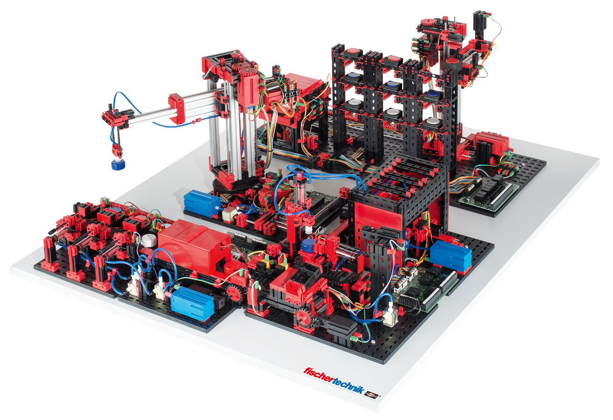

*UC1: Fischertechnik Training Factory - 6 main components: Deliver and Pick-up Station (DPS), Environmental station with surveillance camera (SSC), Vacuum Gripper Robot (VGR), Automated High-bay Warehouse (HBW), Multi-Processing Station with klin (MPO) and Sorting Line with Color Detection (SLD).*

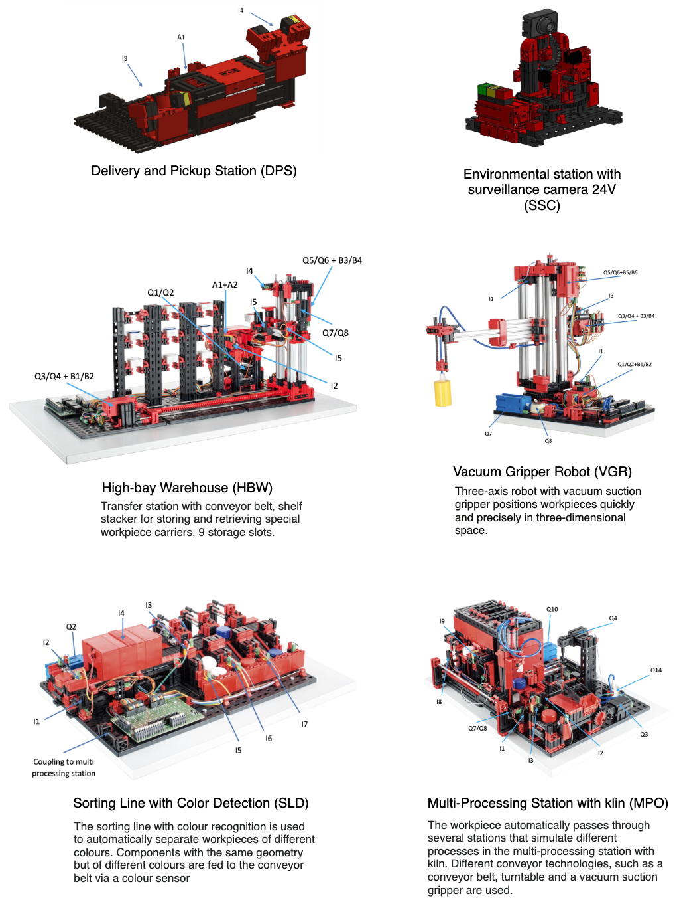 -->

## Part 1: Retriever Agent

The RetrieverAgent handles factory documentation retrieval using a sophisticated knowledge graph approach. It combines structured and unstructured data to provide comprehensive answers to user queries.

### 1. Neo4j DB construction

This process now uses a robust, multilingual pipeline to construct a Neo4j knowledge graph and unified Neo4j Vector Index from unstructured data across multiple use cases (UC1, UC2, etc.). The enhanced pipeline includes:

**Key Features:**
- **Multi-Use Case Support**: Processes documents from different sources (UC1, UC2) with source-based filtering
- **Blank Page Filtering**: Automatically skips pages with only headers/footers or blank page indicators (e.g., "PÁGINA INTENCIONADAMENTE EN BLANCO"), improving data quality and processing efficiency
- **Semantic Chunking**: Uses natural text boundaries for context-aware chunking, preserving semantic meaning for better retrieval and graph extraction
- **Multilingual Embeddings**: Employs HuggingFace sentence-transformers for cross-language retrieval (e.g., English queries on Spanish UC2 documents)
- **Unified Vector Index**: All use cases indexed in a single vector space with `source` property filtering (UC1, UC2, etc.)
- **Consistent Source Labeling**: Standardized `source` property across all nodes and relationships for seamless filtering

<!-- **Enhanced Pipeline Flow:**
```
Multiple PDFs (UC1/UC2) → Blank Page Filter → Semantic Chunking → Language Detection → 
Multilingual Embedding → Neo4j Graph & Unified Vector Index → Source-Filtered Query/Retrieval
``` -->

**Procedure:**

1. **Load and Process PDFs by Use Case**:
   - PDF files are organized by subdirectories (UC1, UC2) and processed with blank page filtering
   - File: `src/utils/pdf_processing.py`
   - Function: `process_subdirectories_individually()` - processes each use case separately
   - Function: `load_and_chunk_pdf()` - includes `is_blank_page()` filtering and semantic chunking

2. **Neo4j Graph Connection with Multilingual Support**:
   - Enhanced connection supporting multilingual embeddings and source filtering
   - File: `src/utils/neo4j_connection.py`
   - Functions: `load_vector_index(source_filter="uc1")`, `create_vector_index()`, `update_vector_index()`

3. **Graph Modeling and Source Labeling**: 
   - Maintains compatibility with Neo4j while adding source-specific metadata
   - Files: `src/utils/graph_modeling.py` and `src/utils/graph_mapping.py`
   - Enhanced with consistent `source` property assignment for filtering

4. **Extract Graph Data with Language Detection**:
   - Each chunk analyzed with automatic language detection and source labeling
   - File: `src/utils/graph_transformer.py`
   - Function: `extract_and_store_graph(document, nodes, rels, source_label)`
   - Features: Language detection, blank page skipping, source property assignment

5. **Store Graph Data with Use Case Organization**:
   - Orchestrates processing across multiple use cases with unified storage
   - File: `src/transform_manual_file_to_neo4jdb.py`
   - Function: `process_subdirectories_with_separate_graphs()`

6. **Create Unified Neo4j Vector Index**:
   - Single vector index supporting all use cases with source-based filtering
   - Uses HuggingFace multilingual embeddings `sentence-transformers/paraphrase-multilingual-MiniLM-L12-v2`
   - Functions: `create_vector_index("documents")`, `update_vector_index("documents")`

**To construct the Neo4j graph from multiple use cases, run:**

```bash
python src/transform_manual_file_to_neo4jdb.py
```

This script processes PDF files in the `manual` folder (organized by UC1, UC2 subdirectories), applies blank page filtering and semantic chunking, extracts graph data with language detection, and stores everything in a unified Neo4j database with multilingual vector index.

**Query Examples by Use Case:**
```python
# Query UC1 documents
from utils.vector_search_examples import search_uc1_documents
results = search_uc1_documents("maintenance instructions")

# Query UC2 documents (English query on Spanish docs)
from utils.vector_search_examples import search_uc2_documents  
results = search_uc2_documents("How to operate the machine?")

# Query all use cases
from utils.vector_search_examples import search_all_documents
results = search_all_documents("safety procedures")
```

**To construct the graph for only specific use case(s), run:**

```bash
# Only uc1 (wipes the database first, then builds the uc1 graph)
python src/transform_manual_file_to_neo4jdb.py --uc uc1

# Only uc2
python src/transform_manual_file_to_neo4jdb.py --uc uc2

# Add uc2 to an existing graph without wiping it
python src/transform_manual_file_to_neo4jdb.py --uc uc2 --no-clean
```

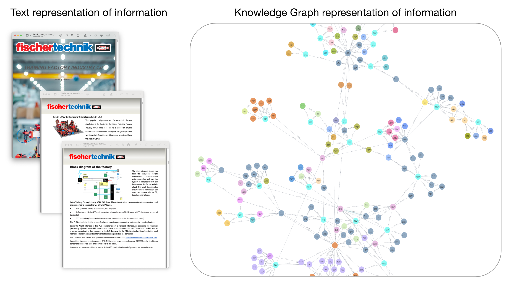
<p align="center">
   <em>Information Extraction Pipeline from Text to Knowledge Graph</em>
</p>

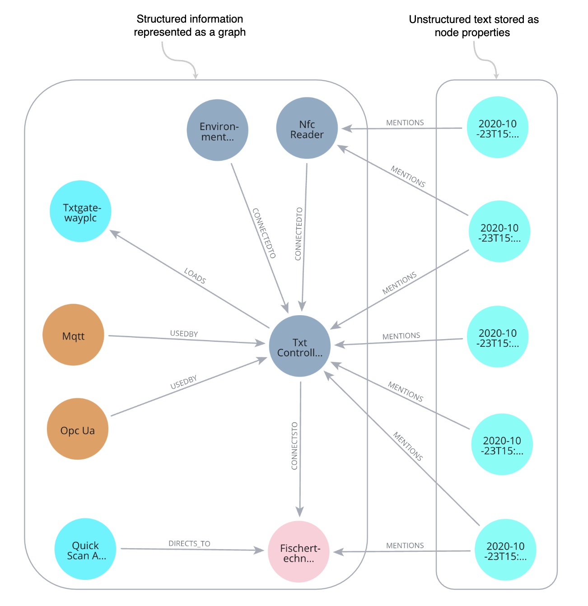
<p align="center">
   <em>Snapshot of KG with explicit links between structured information and unstructured text</em>
</p>

### 2. Retrieval Augmented Generation (RAG) with RetrieverAgent

The `RetrieverAgent` (`src/retriever_agent.py`)integrates Neo4j graph database tools and LLM to provide a retrieval-augmented generation (RAG) system. It combines structured and unstructured data to answer user queries effectively.

 - `Neo4jVectorTool`
   - Performs similarity-based retrieval from the `Neo4jVector` index.
   - Retrieves the most relevant documents based on the user's query.
 - `Neo4jCypherTool`
   - Executes Cypher queries to retrieve structured knowledge from the Neo4j graph.
   - Generates Cypher statements using LLM
 - `RetrieverAgent`
   - Combines the results from both tools to provide a comprehensive answer to user queries.
   - Uses LLM's chat models to generate responses by integrating results from both tools.
   - Maintains chat history using Streamlit's session state and a conversation buffer.
   - Prompt Engineering:
     - The system prompt guides the assistant to provide concise, accurate, and relevant responses.
     - The assistant covers topics such as:
       - Factory components (e.g., high-bay warehouse, suction gripper, sorting line).
       - IoT Gateway, Node-RED dashboards, and cloud integration.
       - Programming tasks, system setup, and educational simulations.

## Part 2: Monitoring Agent

The MonitoringAgent provides real-time monitoring capabilities by interfacing with the SINDIT Knowledge Graph-based Digital Twin framework.

### 1. Set Up the SINDIT Knowledge Graph-Based DT Framework

SINDIT is structured according to the reference architecture for digital twin (DT) systems developed in the COGNIMAN project. It enhances flexibility and modularity through interfaces that connect different components for building knowledge graph-based DTs. See the [SINDIT documentation](https://github.com/SINTEF-9012/SINDIT20) to set up the framework.

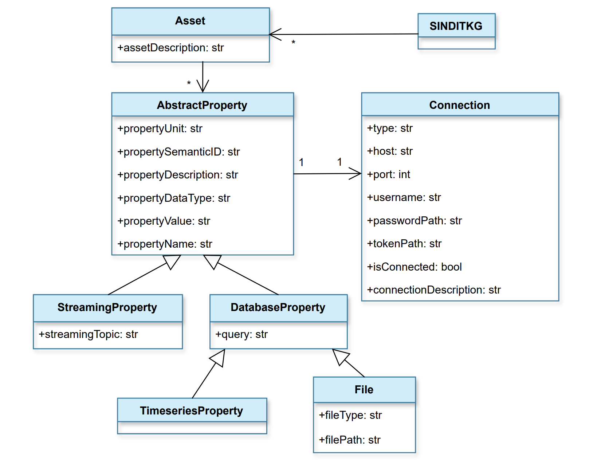
<p align="center">
  <em>SINDIT Knowledge Graph Information Model</em>
</p>

The Data Layer of the Fischertechnik Digital Twin uses MQTT Data Connectors to stream real-time data from the factory's sensors and devices. Refer the MQTT broker setup in the [fischertechnik/txt_training_factory repository](https://github.com/fischertechnik/txt_training_factory/tree/master).

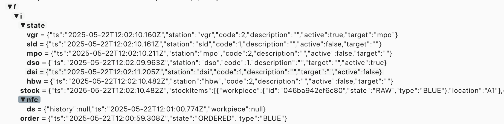
<p align="center">
  <em>Snapshot of the real-time data from MQTT broker</em>
</p>

The connection details are specified in `src/config/connections.json`, where you will see fields like `username` and `passwordPath` for the MQTT connection.

Before setting up the connector, we need to securely store the MQTT credentials. Use the SINDIT DT Platform endpoint `POST vault/secrets` to save the username and password. This ensures that confidential information is managed securely before establishing the MQTT connection.

To automate the setup of the SINDIT knowledge graph and its connections, run the following script:

```bash
python src/sindit_kg.py
``` 

This script streamlines the process of registering MQTT connections, streaming properties, assets, and the knowledge graph itself by interacting with the SINDIT DT Platform. Running the script ensures that all necessary components are properly configured for real-time monitoring and data integration.
   - Register the MQTT connection
   - Register all streaming properties (from `src/sindit2-connection/config/streaming_properties.json`)
   - Register all assets (factory sensor, camera, VGR, HBW, SLD, MPO, DSO, DSI, order)
   - Register the SINDIT knowledge graph (`sindit_kg`)

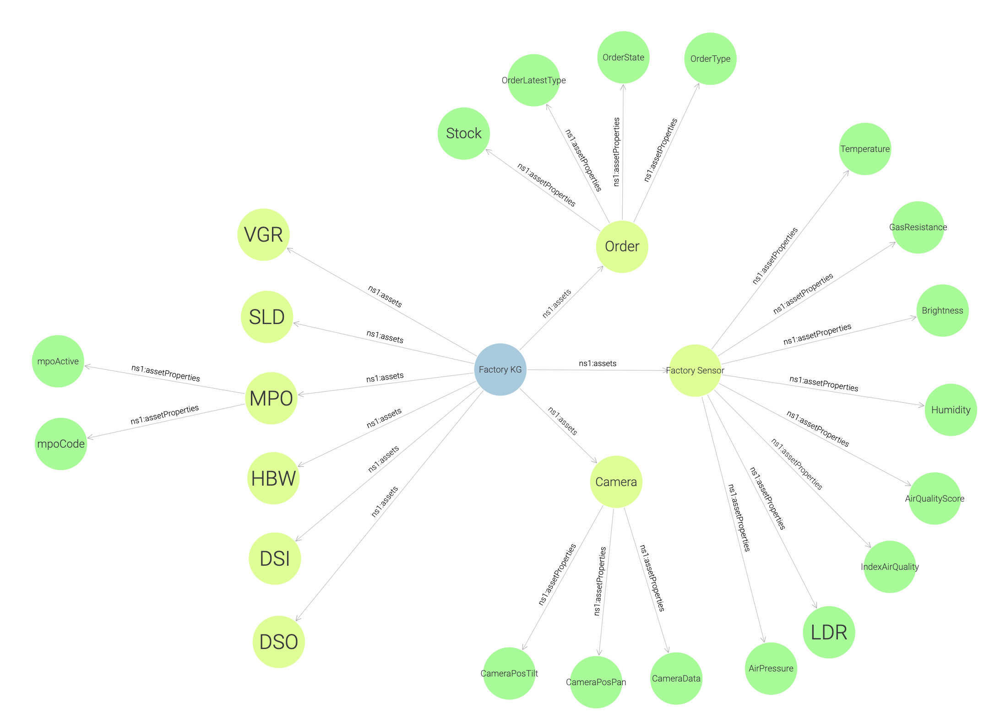

<p align="center">
  <em>Result: Snapshot of the SINDIT graph created for the Fischertechnik factorys</em>
</p>

### 2. Monitoring Agent Architecture

The `MonitoringAgent` (`src/monitoring_agent.py`) is designed to provide real-time monitoring and analysis of manufacturing data by interfacing with the SINDIT Knowledge Graph API. Below is an overview of its main components and functionalities:
  - `SINDITDataTool`: A custom tool that classifies user queries, determines relevant manufacturing assets (e.g., VGR, HBW, sensors), and retrieves real-time data from the SINDIT API. It maps natural language queries to specific asset URIs and fetches associated data, including sensor readings and connection status.
  - `classify_query`: analyzes the user's natural language query to identify relevant manufacturing assets (such as VGR, HBW, sensors, etc.). It maps keywords in the query to specific asset URIs used by the SINDIT Knowledge Graph API, ensuring that data retrieval targets the most relevant components for the user's request.
  - `get_real_time_data`: Retrieves real-time manufacturing data from the SINDIT Knowledge Graph API based on a user query and optional asset/property filters.
  - `query`: The main entry point for user queries. It retrieves real-time data, formats it with the original query, and generates a comprehensive response using the LLM conversation chain.
  - `get_sindit_status`: Fetches the connection status of MQTT connections from the SINDIT Knowledge Graph API.

## Part 3: AnalyticsAgent

The AnalyticsAgent provides comprehensive historical data analysis, visualization, and LLM-powered insights for manufacturing processes.

- **Advanced Analytics**:
  - Process cycle detection
  - Component activity calculation
  - Position movement analysis
  - Environmental condition monitoring

- **LLM-Powered Insights**: Generates comprehensive process explanations using multimodal chart analysis
  

1. Time Series Loading: Load resampled component data
   - File: `src/utils/ts_preprocessing.py`
   - Function: `load_resampled_requested_components()`

2. Visualization Engine: Create interactive charts
   - File: `src/viz.py`
   - Functions: `visualize_factory_overview()`, `visualize_component_activity()`

3. Multimodal LLM Analysis: Generate insights from chart data using advanced multimodal AI
   - File: `src/utils/llm_image_explanation.py`
   - Function: `generate_comprehensive_process_explanation()`
     - Visual + Textual Processing: Combines factory process charts with time series data
     - GPT-4 Vision Integration: Uses multimodal capabilities to analyze charts and correlate with numerical data
     - Domain-Specific Analysis: Tailored for manufacturing processes and factory operations
       - Process cycle detection
       - Component activity calculation
       - Position movement analysis
       - Environmental condition monitoring

## Part 4: Integrated Agent

The Integrated Agent provides a unified interface for factory information retrieval, real-time monitoring, and advanced analytics by orchestrating multiple specialized agents:
  - `RetrieverAgent`: Handles knowledge retrieval, question answering, and context augmentation using the Neo4j knowledge graph and LLM. It is optimized for answering questions about factory structure, documentation, and historical data.
  - `MonitoringAgent`: Focuses on real-time data monitoring, sensor status, and operational insights by interfacing with the SINDIT Knowledge Graph API.
  - `AnalyticsAgent`: Powers historical data analysis, visualization, and AI-driven insights. It supports natural language queries for time series analysis, process cycle detection, and component activity evaluation, leveraging multimodal LLMs for comprehensive process explanations.


## Result

The demo highlights the full capabilities of the multi-agent manufacturing assistant system within a Streamlit application. Users can interact with the following agents:
   - `RetrieverAgent`: Provides knowledge retrieval, question answering, and context augmentation using the Neo4j knowledge graph and LLMs.
   - `MonitoringAgent`: Offers real-time data monitoring, sensor status, and operational insights by interfacing with the SINDIT Knowledge Graph API.
   - `AnalyticsAgent`: Delivers historical data analysis, visualization, and AI-driven insights. It supports natural language queries for time series analysis, process cycle detection, and component activity evaluation, leveraging multimodal LLMs for comprehensive process explanations.
   - `IntegratedAgent`: Combines the functionalities of the above agents to provide a seamless user experience for factory information retrieval, real-time monitoring, and advanced analytics.
  
To run the demo, execute the following command:

```bash
streamlit run src/app.py
```

This command starts the Streamlit application, providing a user-friendly interface for interacting with the agents and visualizing the factory's status.

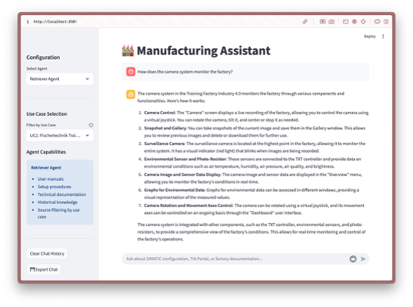

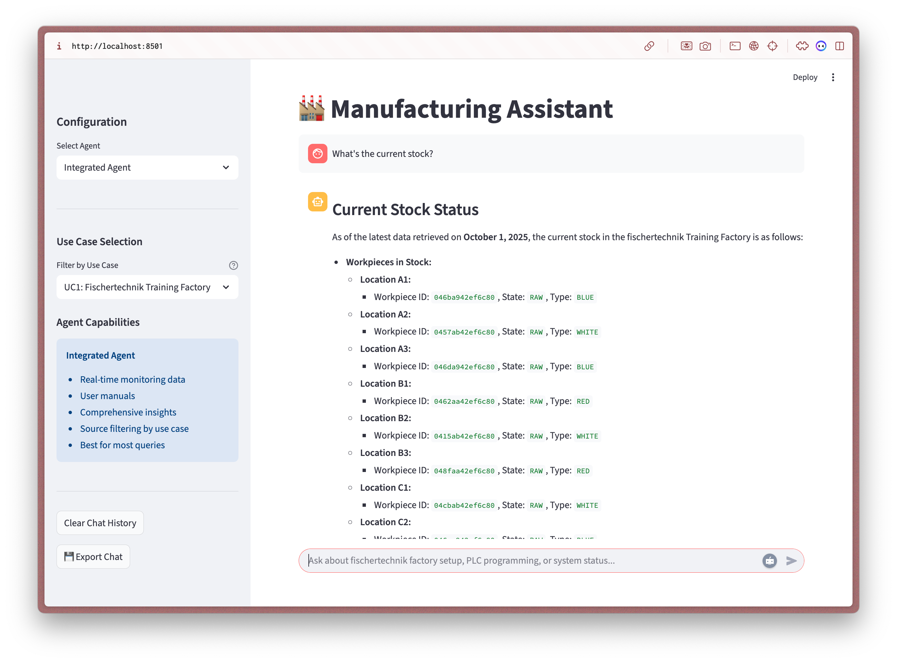

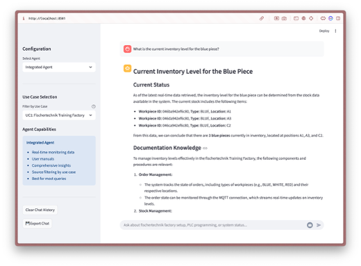

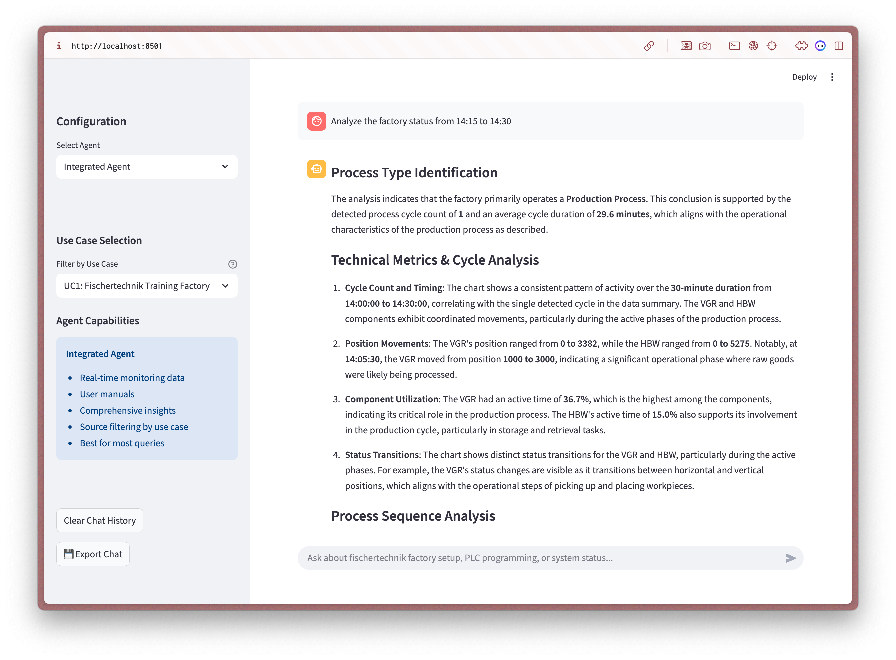

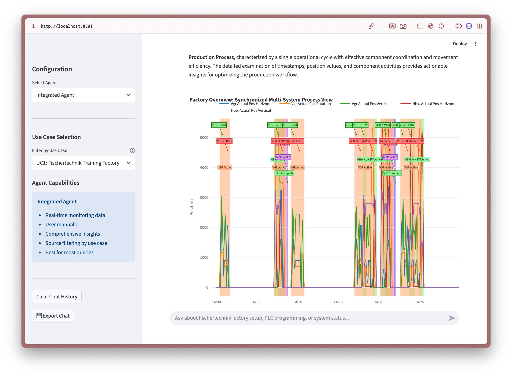